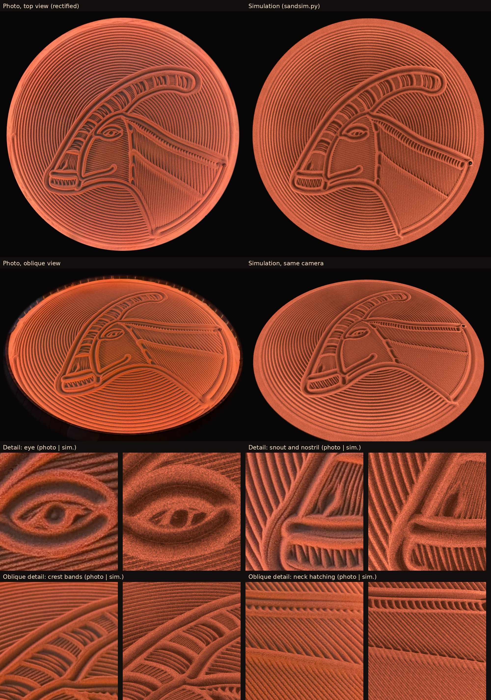

# sandsim – watch a sand table draw, in the browser

**[Open the web app](https://surt91.github.io/sandsim/)**

A simulator for kinetic sand tables as an [egui](https://github.com/emilk/egui) web app in Rust.
Load a theta-rho pattern (`.thr`, as used by Dune Weaver, Sisyphus and Sandify) and watch
the steel ball plough it into the sand, lit by the LED strip around the rim.
The simulation and lighting models were developed and calibrated against photos of a
Dune Weaver Pro with a 10 mm ball in the Python prototype in [`prototype/`](prototype/), which
renders still images from the command line.



## Usage

Requires Rust and [trunk](https://trunkrs.dev/) (`rustup target add wasm32-unknown-unknown`).

```sh
trunk serve --release          # http://127.0.0.1:8080
trunk build --release          # static site in dist/, can be hosted anywhere
```

Everything runs client-side in WebAssembly, so `dist/` can be served by any static web server.
Pushes to `main` are deployed to GitHub Pages by `.github/workflows/pages.yml`.
A native window is available too (`cargo run --release -- pattern.thr`), as well as a headless
benchmark that writes the top and oblique view as PNGs (`cargo run --release -- --bench pattern.thr`).

## Features

- **Patterns**: open a `.thr` file (button or drag & drop), or pick one of the examples.
- **Live animation**: the ball draws the pattern at an adjustable speed (mm/s of ball travel).
  The animation waits for the lighting to keep up, so the actual speed is shown below the
  playback controls. *Skip clearing* and *Finish* simulate without animation.
- **Top and oblique view**: the oblique view is ray-cast with the camera fitted to a photo,
  and can be rotated around the table. It is rendered when the animation is paused or finished.
- **Parameters**: lighting (LED colour, LED height, beam angle, shadows, ambient light, grain,
  exposure) applies immediately; sand and table parameters (angle of repose, sand depth,
  ball size and lag, optional clearing spiral (off by default), table scale, grid) apply on
  *Apply & restart*.
- **Export**: save the current view as PNG.

The orange LED light uses the tone curve calibrated against photos. Other LED colours keep its
brightness curve and tint the sand (`SAND_TINT`) with the chosen colour – an approximation.

## How it stays interactive

The simulation runs on the main thread in time slices per frame; the lighting is spread over
workers (one per spare core, up to 8): web workers in the browser, which works on any static
host such as GitHub Pages, and threads in the native window. Both run the same code, only the
transport differs (`postMessage` / channels): each worker keeps a copy of the height field,
gets the changed regions and lists of tiles to light, and sends back their light values.
With a single core the lighting runs in time slices on the main thread.

- The simulation advances the ball in chunks of 16 steps and reports the changed region.
- Lighting works on 32×32 px tiles. Tiles touched by the ball are re-lit first, closest to the
  ball first, with a reduced LED set (12 instead of 48 LEDs, *LEDs while drawing*). Tiles in
  shadow range are only marked for refinement, which happens with the full LED strip in spare
  time and once the ball stops. Brightness normalisation (95th percentile of direct light,
  median of total light) is estimated from a fixed sample of pixels; the whole image is
  re-coloured with it at most once a second while work is pending. Exposure and colour
  settings only re-colour, they don't re-light.
- The animation runs in waves: the ball moves on until a batch of tiles has changed, these are
  spread evenly over the workers, and the ball only moves on once the whole wave is lit. So the
  shown sand always belongs to one state of the simulation, and the ball is drawn where it was
  in that state. Refinement work fills the workers in between. Every tile has a generation
  counter that is bumped when the sand around it changes, so results that are outdated by the
  time they arrive are recognised.
- The horizon searches stop as soon as even the highest sand within reach could not change
  the result.

A complete run of the zen garden example (177 000 steps of 0.5 mm) takes about 9 s of
simulation natively; in the browser about 1.5–2× that. Lighting and animation speed with
lighting threads (native, 8 cores / 16 threads; `SANDSIM_WORKERS=n cargo run --release --
--bench pattern.thr` and `--bench-live`):

| threads | full lighting (48 LEDs) | animation, as fast as possible |
|---|---|---|
| 0 (main thread) | 5.6 s | 0.25 m/s |
| 2 | 3.0 s | 1.1 m/s |
| 4 | 1.65 s | 2.0 m/s |
| 8 | 1.05 s | 3.2 m/s |
| 15 | 0.87 s | 3.5 m/s |

## License

MIT, see [LICENSE](LICENSE). The Parasaurolophus example (`prototype/examples/parasaurolophus.thr`, its renderings and the
photo comparison) is based
on the life reconstruction
[*Parasaurolophuspic steveoc.jpg*](https://commons.wikimedia.org/wiki/File:Parasaurolophuspic_steveoc.jpg)
by Steveoc 86, licensed under [CC BY 2.5](https://creativecommons.org/licenses/by/2.5/).
